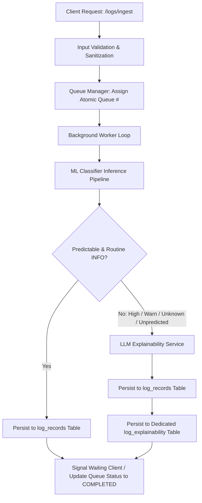

# SentinelLog-AI — Log Triage, Ingestion Queue & Explainability Subsystem

## Overview
This subsystem implements an end-to-end security log processing pipeline adhering to industry-grade secure coding standards. Incoming logs undergo strict schema validation and sanitization, are placed into a FIFO queue assigned with a monotonic ticket number, and are triaged via a hybrid machine learning (ML) and large language model (LLM) decision pipeline:

1. **Secure Ingestion & Validation**: Logs are checked against Pydantic schemas enforcing length boundaries, type constraints, numeric intervals, and sanitization against CRLF / null-byte injection.
2. **Queue Management**: Every ingestion request receives an atomic sequential `queue_number`. The system can either await completion synchronously (wait until predicted and persisted) or return a ticket for asynchronous polling.
3. **ML Model Classification**: Ingested features (`Content`, `Component`, `Hour`, `Minute`, `Second`, `Time_gap`, `Pid_freq`) are processed through the trained scikit-learn pipeline (`hdfs_log_classifier.joblib`).
4. **Conditional LLM Escalation & Explainability**:
   - Routine normal logs (`INFO` with solid classification confidence) are persisted directly without LLM overhead.
   - Any log that is **unpredicted**, **uncertain**, **high-severity (`WARN`, `ERROR`, `CRITICAL`)**, or anomalous is automatically escalated to the LLM service (`Qwen/Qwen2.5-72B-Instruct` or resilient `Sentinel-CyberHeuristic-Expert` fallback).
5. **Database Storage**:
   - All processed logs are saved to the primary `log_records` table with their assigned `queue_number`.
   - Explainable entries (High/Unknown/Unpredicted) are persisted into the dedicated `log_explainability` table with a foreign key relationship to `log_records.id`.

---

## Architectural Workflow



---

## Database Models

### 1. Primary Table: `log_records`
Stores every processed log record in the system.

| Column | Type | Constraints / Description |
|---|---|---|
| `id` | `UUID` | Primary Key, default `uuid4` |
| `queue_number` | `BigInteger` | Unique, Indexed, Monotonically increasing queue ticket |
| `content` | `Text` | Sanitized log message text |
| `component` | `String(255)` | Subsystem / Logger identifier (Indexed) |
| `hour` | `Integer` | Timestamp hour (0–23) |
| `minute` | `Integer` | Timestamp minute (0–59) |
| `second` | `Integer` | Timestamp second (0–59) |
| `time_gap` | `Float` | Delta time in seconds since preceding log |
| `pid_freq` | `Integer` | Process ID frequency statistic |
| `raw_log` | `Text` | Optional raw log string for auditability |
| `predicted_by` | `String(50)` | Classifier origin (`ML`, `LLM`, `ML+LLM`) |
| `prediction` | `String(50)` | Classification label (`INFO`, `WARN`, `UNKNOWN`) |
| `confidence` | `Float` | Calibrated model confidence score |
| `status` | `String(20)` | `COMPLETED` or `FAILED` |
| `has_explainability`| `Boolean` | Flag indicating whether explainability was generated |
| `created_at` | `DateTime(tz)` | Creation timestamp |
| `updated_at` | `DateTime(tz)` | Update timestamp |

### 2. Dedicated Explainability Table: `log_explainability`
Contains **only** logs that required deep security explainability (High severity, Unknown, or ML-unpredicted anomalies).

| Column | Type | Constraints / Description |
|---|---|---|
| `id` | `UUID` | Primary Key, default `uuid4` |
| `log_id` | `UUID` | Foreign Key (`log_records.id`, ON DELETE CASCADE), Unique, Indexed |
| `queue_number` | `BigInteger` | Queue reference for auditing (Indexed) |
| `threat_level` | `String(50)` | Threat classification (`HIGH`, `CRITICAL`, `MEDIUM`, `UNKNOWN`) |
| `detection_summary`| `Text` | Concise summary of the detected anomaly |
| `explanation` | `Text` | Deep root-cause explainability analysis |
| `recommended_action`| `Text` | SOC remediation instructions |
| `llm_model` | `String(100)` | Inference engine (`Qwen/Qwen2.5-72B-Instruct` or fallback) |
| `confidence_score` | `Float` | Confidence score for the explainability assessment |
| `created_at` | `DateTime(tz)` | Timestamp of analysis |

---

## Secure Coding Practices Implemented

1. **Input Length & Memory Limits**: Strict Pydantic validations (`max_length` bounds on text strings and arrays) to eliminate Denial-of-Service (DoS) and memory exhaustion vectors.
2. **Sanitization against Injection**: Stripping `\x00` null bytes and non-printable control characters `\x01-\x1f` to prevent log injection and CRLF header manipulation.
3. **Parameterization**: All database interaction utilizes SQLAlchemy parameterized expressions (`select()`, `save_log_record()`), ensuring 100% immunity to SQL injection.
4. **Resilient LLM Fail-Safe**: When external LLM APIs face quota exhaustion (e.g. HuggingFace HTTP 402/429) or network failure, an internal expert cybersecurity heuristic analyzer seamlessly activates, guaranteeing zero dropped logs or hung queues.
5. **Atomic Queue Sequencing**: Thread-safe monotonic ticket assignment synced with persistent database state across restarts.
6. **Graceful Worker Lifecycle**: FastAPI `lifespan` manager ensures background queue tasks start safely and drain on shutdown.

---

## API Endpoints Reference

### 1. Ingest Log
- **Endpoint**: `POST /logs/ingest?wait=true`
- **Description**: Enqueues a log entry with an auto-assigned queue number. If `wait=true` (default), waits until predicted and persisted in the database.
- **Request Body**:
```json
{
  "content": "WARN org.apache.hadoop.hdfs.server.datanode.DataNode: Block blk_999999 is corrupted, checksum verification failed",
  "component": "dfs.DataNode",
  "hour": 20,
  "minute": 38,
  "second": 12,
  "time_gap": 117.0,
  "pid_freq": 5
}
```
- **Response** (Synchronous):
```json
{
  "queue_number": 6,
  "status": "COMPLETED",
  "log_id": "82d39f77-6c17-47c6-bbe8-d61bb3efa08f",
  "predicted_by": "ML+LLM",
  "prediction": "WARN",
  "confidence": 0.6917,
  "has_explainability": true,
  "explainability": {
    "id": "e602544b-ab02-486d-9892-7b65df133c19",
    "log_id": "82d39f77-6c17-47c6-bbe8-d61bb3efa08f",
    "queue_number": 6,
    "threat_level": "HIGH",
    "detection_summary": "Abnormal process/packet responder termination in HDFS DataNode component (dfs.DataNode).",
    "explanation": "A packet responder or pipeline thread terminated abruptly while servicing a data block. Raw log: '...' In distributed storage systems, premature termination typically stems from network packet drops, disk I/O bottlenecks...",
    "recommended_action": "1. Inspect DataNode disk I/O health and NIC error counters. 2. Check replication status for the impacted block via HDFS fsck...",
    "llm_model": "Sentinel-CyberHeuristic-Expert",
    "confidence_score": 0.88,
    "created_at": "2026-10-28T12:55:40.128655Z"
  },
  "message": "Log processed with ML and escalated for deep explainability in dedicated table."
}
```

### 2. Ingest Batch Logs
- **Endpoint**: `POST /logs/batch`
- **Description**: Safely ingests up to 100 log records in batch, assigning sequential queue numbers.

### 3. Check Queue Item Status
- **Endpoint**: `GET /logs/queue/{queue_number}`
- **Description**: Retrieves current processing status and results for a given queue ticket number.

### 4. Query Queue Metrics
- **Endpoint**: `GET /logs/queue/metrics`
- **Description**: Returns total enqueued, active worker count, completed/failed tasks, and queue depth.

### 5. Query Dedicated Explainable Table
- **Endpoint**: `GET /logs/explainable?threat_level=HIGH&limit=50`
- **Description**: Directly queries the `log_explainability` table for high/unknown anomalous records.

### 6. Query Single Log Record
- **Endpoint**: `GET /logs/{log_id}`
- **Description**: Retrieves a log record and its joined explainability object if applicable.

### 7. List Ingested Logs
- **Endpoint**: `GET /logs?prediction=WARN&component=dfs.DataNode&limit=20`
- **Description**: Paginated query of log records with optional filters.
